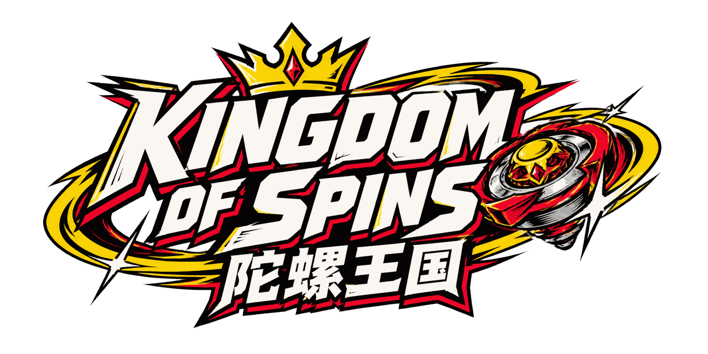

<p align="center">
  
</p>

<p align="center">
  <strong>中文</strong> · <a href="README.en.md">English</a> · <a href="https://kingdom-of-spins.deskmind-site.workers.dev">在线体验</a>
</p>

# Kingdom of Spins · 陀螺王国

一个由孩子设计玩法的 Beyblade X 风格陀螺对战游戏，参加 **Kids for AI Hackathon**。

- **线上地址**：https://kingdom-of-spins.deskmind-site.workers.dev
- **对战是真的在算物理**：MuJoCo 3.15 刚体物理（WASM，4 kHz，RK4）在浏览器的 Web Worker 里实时计算，不是预先做好的动画。
- **AI「融合博士」**：孩子说出想要什么样的陀螺，AI 设计 2–3 个各有取舍的融合方案，讲解背后的 Beyblade X 知识和物理原理，赛后只引用真实对局数据做复盘。
- **漫画风**：界面是日本少年漫画分镜（网点、粗黑框、拟声字），对战是卡通着色 3D。
- **中英文体验**：界面、探索、科学绘本、AI 解说和配音支持中文与英文，优先适配 iPad，也支持手机。主 logo 和装饰性美术字保留原样。

> ⚙ **诚实边界**：物理是理想化模型（简化的零件形状、估算的摩擦和阻力），没有用真陀螺校准过。它能教物理规律和科学方法，但不能预测真实比赛结果。界面和 AI 复盘都会标注「模型结果 / 在这个模型里」。

## 玩法

孩子的原始设计（节选）：
> at the first of the game you can choose your starter beys and battle normal bladers and when you have 3 beys you can battle pro bladers and when you win against pro bladers you can let them be on your team … fish and dragoon is fishgoon … only the blade will change, the ratchet and the bit will not change.

| 模式 | 内容 |
|---|---|
| 剧情模式 | 选初始陀螺 → 打普通对手赚金币 → 商店盲盒 / AI 融合 → 集齐 3 只解锁职业对手 → 打赢后招募入队并送他一只陀螺 → 队员满 3 人解锁超级职业 → 最终 Boss 龙王 |
| 对战模式 | 对 CPU（可做"只改一个变量"的实验）；或用房间码约朋友联机（Cloudflare Durable Objects） |

每局走一遍学习循环：**说出目标 → AI 设计 → 先预测 → 物理对战 → 看证据复盘 → 只改一个变量再试**。

计分沿用官方规则：Xtreme Finish 3 分、Over Finish 2 分、Spin Finish 1 分，先拿 4 分获胜（演示模式改为 2 分）。爆裂机构没有建模，所以不会出现 Burst Finish。

## AI 做了什么

| 功能 | 说明 |
|---|---|
| 融合设计 `POST /api/ai/fusion/chat` | 愿望太模糊时先追问一次；之后给出 2–3 个方案。服务端会把参数校验并夹到安全范围内：只有 Blade 可以变，Ratchet 和 Bit 从保留的那只父陀螺继承。每个方案都引用知识卡 |
| 赛后复盘 `POST /api/ai/commentary` | 输入这一局的物理事件摘要（碰撞时刻、转速、终结方式），输出带时间的故事、一个科学知识点，以及"只改你陀螺的一个地方"的实验建议 |
| 自由提问 `POST /api/ai/ask` | 孩子问"为什么外圈重就转得久？"，AI 结合知识卡用简短的话回答 |
| 绘图生成 `POST /api/ai/sketch` | 上传梦想陀螺的画，AI 识别外形、颜色和刃片，生成经过参数校验的设计与招式 |
| 科学绘本与探索 | 从陀螺结构、对战瞬间和场景热点进入互动实验、知识卡与小测验 |
| 知识库 `src/knowledge/cards.js` | 分三层：**官方事实**（Beyblade X 结构、计分）、**物理知识**（转动惯量、摩擦、动量、进动、材料、科学方法）、**游戏设定**（原创融合规则） |

AI 优先通过 Cloudflare AI Gateway 调用 Claude；文字功能可以回退到 Workers AI 和确定性模板。绘图识别需要可用的视觉模型，失败时会提示重试。配音使用预生成角色语音、Fish Audio 和浏览器朗读，按语言和角色区分缓存。

## 技术架构

```
浏览器
 ├─ React 19 + Vite（漫画风 UI）
 ├─ Three.js / react-three-fiber（卡通着色 + 描边 + 泛光）
 └─ Web Worker：MuJoCo WASM 物理，60 Hz 采样，边算边播
Cloudflare Worker（kingdom-of-spins）
 ├─ 静态资源 + /api/ai/*（Workers AI 绑定）
 └─ /ws/room/:code → BattleRoom Durable Object（联机房间）
Supabase
 └─ 家长 Google 登录、孩子档案、云存档（行级安全）
```

**联机对战**：双方各自锁定陀螺和发射参数后，由 Durable Object 下发同一份输入。两边浏览器各自运行同一份确定性物理，再把结果交给服务端核对；结果不一致时以房主为准，并做标记。`scripts/physics.test.mjs` 验证了相同输入产生完全相同的对局。

## 本地运行

推荐 Node 24，与 CI 保持一致；pnpm 版本固定在 `package.json` 的 `packageManager` 字段。

```sh
corepack enable
pnpm install --frozen-lockfile
pnpm worker:dev     # Cloudflare Worker（AI + 联机），127.0.0.1:8787
pnpm dev            # 前端，http://127.0.0.1:5173（/api 和 /ws 会代理到 8787）
pnpm test           # 单元测试：物理/Worker、存档同步、联机、AI、复盘、异步任务/录音清理、融合选材
pnpm deploy         # 构建并部署到 Cloudflare
```

调平衡用的脚本：`node scripts/balance.mjs dragoon charge 3`、`node scripts/run-battle.mjs dragoon fish`。

单元测试使用 Node 自带的测试运行器，云存档、Durable Object 存储、WebSocket 和计时器均在本地隔离，不需要登录或 AI API Key。`scripts/room-smoke.mjs`、`scripts/room-sync.proto.mjs` 和 `scripts/ai-test.mjs` 是另行运行的服务集成检查，不包含在 `pnpm test` 中。

本地 AI/TTS 密钥放在被忽略的 `.dev.vars` 中。前端默认使用项目的公开 Supabase 配置；其他环境可在 `.env.local` 设置 `VITE_SUPABASE_URL` 和 `VITE_SUPABASE_ANON_KEY`。客户端只能使用 publishable/anon key。

## CI/CD

[CI/CD 工作流](.github/workflows/ci-cd.yml) 自动完成：

- **PR → `main`**：安装锁定的依赖，运行全部单元/集成测试、生产构建和 Worker 打包检查。
- **合并到 `main`**：再次通过检查后，将该次构建产物发布到 Cloudflare Workers，并检查线上健康接口和静态资源。
- **手动发布**：在 Actions 中选择 `CI / CD` → `Run workflow`，分支选 `main`。

生产凭据只提供给发布任务；PR 不发布。详细配置、令牌权限、发布排队和回滚见 [CI/CD 说明](docs/ci-cd.md)。浏览器功能走查仍独立运行，覆盖范围见 [i18n 与 E2E 记录](docs/i18n-e2e.md)。

## 目录

| 路径 | 内容 |
|---|---|
| `src/physics/` | 陀螺和场地模型、MuJoCo 适配、对局规则（出界、停转、判定） |
| `src/game/` | 陀螺目录、剧情角色、存档、物理 Worker 和回放器、发射参数 |
| `src/scene/` | 3D 漫画风：陀螺模型、场地、对战场景、展示台 |
| `src/fusion/`, `src/ai/`, `src/knowledge/` | AI 融合工坊、AI 客户端和模板兜底、知识卡 |
| `src/ui/` | 各个页面 |
| `worker/` | Cloudflare Worker、AI 接口、BattleRoom |
| `supabase/` | 数据库迁移、Google 登录启用脚本 |

## 美术素材

把素材放进 `public/art/` 就会自动替换程序生成的占位图，文件名见 `CONTRACT.md`。没有素材也能完整运行。

## 致谢与许可

- 物理引擎：MuJoCo（Apache-2.0）；渲染：Three.js（MIT）。第三方声明见 `THIRD_PARTY.md`。
- Beyblade 是 Takara Tomy / Hasbro 的商标。本项目是非商业的儿童学习作品，陀螺和角色名称来自孩子的原创设定或只作灵感参考，未使用官方素材。
- 物理原型和研究来自前期调研交接包（Spin Lab）。
